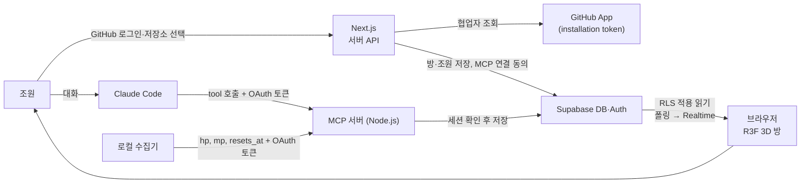

# PRD: 팀 작업 현황 3D 오피스

- 작성일: 2026-11-17 (개정: GitHub App 연동, 저장소 단위 방)
- 근거 문서: `팀 작업 현황 3D 오피스 기획서.md`
- 상태: 초안 (열린 질문 확정 전)

## 1. 개요

조원이 AI(Claude / Claude Code)와 대화하면 MCP 서버가 작업 상태를 기록하고, 아이소메트릭 3D 방에서 캐릭터 위치로 그 상태를 실시간 표시하는 팀 현황 서비스.

각자 GitHub 계정으로 로그인해 저장소를 고르면 그 저장소가 하나의 방이 되고, 저장소 협업자가 방의 조원이 된다. 저장소가 개인 소유·비공개·organization 소유인지와 관계없이, 로그인한 사람이 접근할 수 있고 GitHub App이 설치된 저장소라면 동작한다.

## 2. 문제 정의

팀 프로젝트에서 "누가 지금 무엇을 하는지" 알려면 메신저를 뒤지거나 직접 물어봐야 한다. 상태를 따로 입력하는 도구는 귀찮아서 금방 안 쓰게 된다. 조원 명단을 따로 관리하는 것도 번거롭다.

## 3. 목표와 성공 기준

| 목표 | 성공 기준 |
| --- | --- |
| 상태 입력 자동화 | 조원이 대화 한 문장으로 상태를 바꿀 수 있다 (별도 UI 입력 없음) |
| 조원 등록 자동화 | 저장소를 고르면 협업자가 조원으로 자동 등록된다 |
| 팀 현황 한눈에 파악 | 3D 방 화면 하나로 전원의 상태·작업·HP/MP·이슈를 확인할 수 있다 |
| 실시간 반영 | 상태 변경 후 10초 이내 화면 반영 (폴링 단계 기준) |
| 병목 조기 발견 | 장기 작업·이슈 보유 조원이 시각적으로 구분된다 |
| 비공개 정보 보호 | 방의 조원이 아닌 사람은 그 방의 어떤 데이터도 읽을 수 없다 |
| 포트폴리오 | MCP 서버 설계, OAuth 연동, 상태 기반 3D UI, 실시간 데이터 반영을 한 프로젝트로 시연 가능 |

## 4. 사용자

| 사용자 | 니즈 |
| --- | --- |
| 조원 | 따로 입력하지 않고 대화만으로 상태 공유 |
| 방 생성자 | 저장소만 고르면 조원 명단이 자동으로 갖춰짐 |
| 팀장 / 팀 전체 | 누가 막혔는지, 누가 쉬는지 한눈에 확인 |
| 발표 청중 / 평가자 | 팀 협업 과정을 시각적으로 이해 (시연은 조원 계정으로 진행) |

## 5. 범위

**포함 (In Scope)**

- GitHub App 기반 로그인, 저장소 선택, 협업자 동기화
- 저장소 단위의 여러 방 (한 사람이 여러 방에 속할 수 있음)
- OAuth 로그인 기반 MCP 인증(Supabase OAuth 2.1 서버, Claude Code·로컬 수집기 공통)과 tool 8종
- Supabase DB와 방 조원만 읽을 수 있는 RLS
- Next.js + R3F 기반 아이소메트릭 3D 방 (18×14, 작업·회의·휴식·완료 정리·대기석 5구역 + 가운데 통로, 디자인 시안 v2)
- 캐릭터 이동·말풍선, 이력 패널, 장기 작업 경고
- HP·MP 바 (자기 보고 → 로컬 수집기 자동 수집)
- 이슈 배지·벽면 이슈 보드
- GitHub Projects(칸반) 카드 상태 → 대시보드 status 단방향 연동 (조직·개인 소유 모두)
- 웹·MCP에서 상태 직접 선택(덮어쓰기), 캐릭터 카드·파트 선택, 방장 칸반 연결 설정

**제외 (Out of Scope)**

- 4가지 외 사용자 정의 status
- 대시보드에서 GitHub(칸반)로 쓰기 (연동은 GitHub → 대시보드 단방향)
- Notion → GitHub 자동 반영 (15장 고도화)
- GitHub 이외의 로그인 수단 (GitLab, 이메일 등)
- 로그인하지 않은 사람에게 방 공개
- 모바일 전용 UI (PWA는 홈 화면 설치만 지원, 2026-11-18 사용자 요청. 웹 푸시는 15장 향후 확장)
- 인증 토큰(Claude 자격 증명)의 서버 전송·저장

## 6. 기능 요구사항

### 6.1 status 정의

직접 선택할 수 있는 상태는 4가지로 고정한다(DB·MCP). `idle`(대기)은 칸반에 진행 중 카드가 없는 github 조원에게 최종 상태 뷰가 계산해 주는 표시 전용 값이다. 정확한 자리 좌표는 `web/src/constants/office.ts`(`WORK_SLOTS`·`ZONE_SLOTS`, 디자인 시안 v2)가 기준이다.

| status | 표시 이름 | 구역 (시안 v2) | 의미 |
| --- | --- | --- | --- |
| coding | 작업 중 (DB 값은 coding 유지, 2026-11-18 표시 이름 변경) | 뒤 왼쪽 작업 구역: 개발 모니터 책상 / 디자인 드로잉 책상 / 기획 화이트보드 (파트별 하위 자리) | 개발·디자인·기획 작업 |
| meeting | 회의 중 | 앞 가운데 원형 테이블 | 팀 회의·페어 작업 |
| break | 휴식 중 | 앞 오른쪽 소파 | 자리 비움·휴식 |
| done | 완료 정리 | 앞 왼쪽 책장 앞 | 작업 완료 후 기록 정리 |
| idle | 대기 (표시 전용) | 뒤 오른쪽 대기석 벤치 (출입문 옆) | 칸반 연동 조원인데 진행 중 카드가 없음 |

칸반 열 매핑 (기본값, 방별로 바꿀 수 있음): Backlog·Ready → 대기 / In progress → 작업 중 / In review → 작업 중 + "검토 중" 태그 / Done → 완료 정리(열 이동 후 30분), 이후 대기. GitHub 열 이름은 그대로 저장하고 화면 표시만 한국어로 한다.

### 6.2 기능 목록

| ID | 기능 | 우선순위 | 수용 기준 |
| --- | --- | --- | --- |
| F1 | GitHub 로그인 | P0 | GitHub App 사용자 인증으로 로그인하면 GitHub id 기준으로 `members` 행과 연결된다 |
| F2 | 저장소 선택·방 생성 | P0 | 로그인한 사람이 접근할 수 있고 App이 설치된 저장소 목록이 보이고, 하나를 고르면 방이 생긴다. App이 설치되지 않았으면 설치 링크를 안내한다 |
| F3 | 협업자 동기화 | P0 | 방 생성 시와 "새로고침" 시 저장소 협업자가 `room_members`로 동기화된다. 저장소에서 빠진 사람은 삭제하지 않고 `active = false`로 숨긴다 |
| F4 | MCP 연결 (OAuth 로그인) | P0 | 웹에서 `claude mcp add`(헤더 없음) 명령을 복사해 등록하고, Claude Code `/mcp` → Authenticate로 브라우저가 열리면 GitHub 로그인 후 동의 화면(`/oauth/consent`)에서 허용한다. 토큰은 Supabase OAuth 서버가 발급·갱신하며 화면에 나오지 않는다. 첫 화면에서 연결된 앱을 보고 해제할 수 있고, 해제하면 MCP 서버가 바로 거부한다. 로컬 수집기도 `--login`으로 같은 방식으로 로그인한다 (2026-11-18 개인 토큰 발급에서 변경) |
| F5 | 대화로 상태 변경 | P0 | "로그인 API 작업 시작"이라고 말하면 Claude가 `update_status`를 호출해 해당 방의 statuses 갱신과 logs 기록이 된다. 호출자는 OAuth 액세스 토큰(로그인 세션)으로 식별하며 남의 상태는 바꿀 수 없다 |
| F6 | 3D 방 렌더링 | P0 | 정사영 카메라의 아이소메트릭 방에 5개 구역(시안 v2: 작업·회의·휴식·완료 정리·대기석)과 가운데 통로가 보이고, 캐릭터가 status에 맞는 구역에 서며 말풍선에 task를 띄운다. MCP를 연결하지 않았거나 상태가 없는 조원은 흐리게 "미연결"로 표시한다 |
| F7 | 자리 겹침 방지 | P0 | 같은 구역 인원은 정해진 자리(작업 구역은 파트별 `WORK_SLOTS`, 부족하면 다른 파트 자리를 빌림 · 나머지는 `ZONE_SLOTS`)에 순서대로 앉아 겹치지 않는다. 이름표·말풍선은 겹침 방지 배치(시안 v2 docs/overlap-rules.md)로 놓는다 |
| F8 | 작업 이력 패널 | P1 | 캐릭터 클릭 시 현재 작업과 완료 기록(logs)을 보여준다 |
| F9 | 장기 작업 경고 | P1 | 개발 중(coding) 상태로 같은 작업이 1시간 이상 지속되면 말풍선 색이 바뀌고 "오래 지속 중 · 도움 필요?"가 붙는다 (기준 시간 1시간: 2026-11-17 확정) |
| F10 | 이슈 배지 | P1 | open 이슈가 있는 조원 머리 위에 `!` 아이콘이 뜬다. status와 독립적이라 "개발 중인데 막힘"을 표현한다 |
| F11 | 이슈 보드 | P1 | 벽면 이슈 보드를 클릭하면 방의 전체 이슈 목록이 열린다 |
| F12 | HP·MP 바 | P1 | 캐릭터 머리 위에 HP(빨강)·MP(파랑) 게이지와 리셋까지 남은 시간이 표시되고, 남은 양 20% 이하면 깜빡인다. 게이지는 남은 양(100 − 사용률)으로 그리고, 마우스를 올리면 "100% 중 몇 % 남음"·사용률·리셋까지 남은 시간·보고 시각을 툴팁으로 보여준다 (2026-11-17 확정) |
| F13 | MP 소진 처리 | P2 | MP가 바닥난 조원은 break 구역에 "MP 회복 중"으로 표시된다 |
| F14 | HP·MP 자동 수집 | P2 | 로컬 수집기가 10~15분 간격으로 사용률만 서버에 보낸다. 실패 시 `report_usage` 자기 보고로 대체 가능 |
| F15 | 실시간 갱신 | P0 → P2 | 5~10초 폴링으로 시작해 Supabase Realtime 구독으로 전환한다 |
| F16 | 기본 상태 출처 | P1 | 조원(방별)마다 `status_source`('github' / 'manual', 기본 manual). 직접 선택이 없을 때 따르는 출처이며, 직접 선택은 출처와 무관하게 항상 우선한다 |
| F17 | GitHub 칸반 동기화 | P1 | `status_source = github` 조원의 칸반 상태가 폴링 주기(기본 45초) 안에 반영된다. 일반 이슈·PR·초안 이슈 모두 대상. task = 카드 제목, 카드 URL·번호(초안이면 "초안")·파트·진행 중 카드 개수를 저장. 진행 중 카드가 여러 개면 가장 최근 수정된 1개 + 개수. 담당자 GitHub login ↔ 조원 login으로 매칭 |
| F18 | 직접 선택(덮어쓰기) | P1 | 모든 조원이 4개 status와 task를 웹(이력 패널)·MCP로 직접 고른다. 해제 방식: 2시간 후 자동 복귀(기본) / "칸반으로 돌아가기"로 해제할 때까지 유지. 덮어쓰기 중 칸반 변경은 저장만 하고 화면에는 반영하지 않으며, 해제 시 최신 칸반 상태로 복귀. 우선순위: 유효한 직접 선택 > github이면 칸반 > 기존 값 |
| F19 | 파트 표시 | P1 | 방에 처음 들어갈 때 캐릭터 카드(냥냥·새싹·삐삐·몽글)와 파트(개발·디자인·기획)를 고른다(방별, 필수, 기본값 없음, 나중에 변경 가능). 카드 "파트" 필드가 있으면 카드 파트, 없으면 조원 파트. 이름표 배지·옷차림·작업 하위 자리로 보인다 |
| F20 | 동기화 상태 | P1 | 마지막 동기화 시각·실패 사유를 저장하고 방 화면 HUD와 방 설정에 표시한다. 실패해도 기존 상태를 지우지 않는다. PAT 만료·폐기는 방장에게 배너로 알린다 |
| F21 | 표시용 상태 정보 | P1 | 현재 상태의 출처(github / manual_timed / manual_pinned), 만료 시각, 덮어쓰기로 가려진 칸반 카드를 함께 제공한다 (`effective_statuses` 뷰). 화면은 출처 아이콘(링크 / 연필+시계 / 연필+핀)으로 보여준다 |

### 6.3 HP·MP 정의

| 게이지 | 실제 한도 | 소스 필드 | 특징 |
| --- | --- | --- | --- |
| HP | 주간 한도 (7일) | `seven_day` | 총량. 소진 시 회복까지 며칠 걸릴 수 있음 |
| MP | 5시간 세션 한도 | `five_hour` | 단기 사용량. 5시간 단위 회복 |

- 플랜마다 한도가 달라 절대값이 아닌 사용률(%)로 저장한다.
- 사용량은 사람 단위다. 한 사람이 여러 방에 있으면 모든 방에 같은 HP·MP가 보인다.

## 7. 시스템 아키텍처

**규칙**

- 이슈·사용량 쓰기는 MCP 서버만 한다. 상태 쓰기는 MCP 서버와 웹 서버 액션이 같은 DB 함수(`set_status`·`release_status`, service_role만 실행)로 한다.
  - 변경 근거 (2026-11-18, M9): Claude Code를 쓰지 않는 디자인·기획 조원도 상태를 직접 골라야 한다(F18). 브라우저에 쓰기 RLS를 여는 대신, 서버 액션이 로그인·조원 여부를 다시 확인하고 secret 키로 같은 DB 함수를 부른다. 브라우저는 여전히 읽기만 한다.
- 칸반 카드(`github_cards`)와 동기화 상태는 MCP 서버의 동기화 스케줄러만 쓴다. 대시보드에서 GitHub로는 쓰지 않는다(단방향).
- 최종 상태(직접 선택·칸반 우선순위)는 DB 뷰 `effective_statuses` 한 곳에서만 계산한다. 웹·MCP는 이 뷰를 읽는다.
- 웹은 로그인, 방 생성, 협업자 동기화, MCP 연결 승인·해제, 직접 선택, 캐릭터·파트 선택, 방장 칸반 설정을 쓴다. 이 쓰기는 브라우저가 아니라 서버 측 코드(Server Action·Route Handler)가 service_role 키로 처리한다.
- 브라우저는 Supabase를 로그인 사용자 권한으로 읽기만 하며, RLS가 방 조원 여부를 검사한다.



### 7.1 GitHub App 연동

- **App 권한 (최소):** Repository `Metadata: read` (협업자 목록·저장소 정보), Account `Email addresses: read` (Supabase Auth가 로그인 시 이메일을 요구함). 코드 읽기·쓰기 권한은 요청하지 않는다.
- **등록:** `web/scripts/create-github-app.mjs`가 App Manifest 방식으로 만들고 자격 증명을 `web/.env.local`에 저장한다. public App이어야 다른 계정·organization에 설치할 수 있다.
- **설치:** 저장소 소유자(개인 또는 org 관리자)가 App을 설치하고 대상 저장소를 고른다. org 저장소는 관리자 승인이 필요하다.
- **로그인:** GitHub App의 사용자 인증(OAuth 흐름)을 Supabase Auth GitHub provider로 처리한다. 로그인 콜백에서 GitHub 사용자 토큰(`provider_token`)을 httpOnly 쿠키(8시간)에 저장해 저장소 목록 조회에 쓴다. Supabase는 이 토큰을 보관하지 않는다.
- **저장소 목록:** 사용자 토큰으로 `GET /user/installations` → `GET /user/installations/{id}/repositories`를 호출해, 로그인한 사람이 접근할 수 있으면서 App이 설치된 저장소만 보여준다.
- **협업자 조회:** installation token으로 `GET /repos/{owner}/{repo}/collaborators`를 호출한다. App 토큰으로 조회하므로 방 생성자의 저장소 권한(읽기/쓰기)과 관계없이 동작한다.
- **동기화 시점:** 방 생성, 방의 "새로고침" 버튼. 웹훅(`member` 이벤트) 자동 동기화는 향후 확장.
- **비밀 값:** App private key, client secret은 서버 환경 변수에만 둔다.

### 7.2 MCP 인증

- MCP 클라이언트는 MCP 인증 사양대로 OAuth 2.1(PKCE, 동적 클라이언트 등록)로 로그인한다. 인증 서버는 Supabase Auth의 OAuth 서버(`supabase/config.toml` `[auth.oauth_server]`), 동의 화면은 웹 `/oauth/consent`다. 아래 명령으로 등록한 뒤 Claude Code `/mcp`에서 Authenticate를 고른다.
  ```
  claude mcp add team-office --transport http https://<서버>/mcp
  ```
- MCP 서버는 토큰이 없으면 401 + `WWW-Authenticate: Bearer resource_metadata=...`로 인증 서버를 알려 준다(`/.well-known/oauth-protected-resource`, RFC 9728). 토큰은 Supabase Auth `getUser`로 세션이 살아 있는지까지 확인하고 `members.auth_user_id`로 호출자(member)를 찾는다. tool 입력에 이름을 받지 않는다.
- 웹에서 한 번도 로그인하지 않은 사람(members 연결 없음)은 거부한다. 연결 해제(revokeGrant)·로그아웃한 세션의 토큰도 즉시 거부한다.
- 방이 필요한 tool은 `repo`(`owner/name`)를 받는다. Claude Code가 현재 폴더의 git remote로 채운다. 서버는 호출자가 그 방의 active 조원인지 검사한다.
- 로컬 수집기는 `--login`으로 같은 OAuth 흐름을 거쳐 토큰을 `~/.team-office/collector.json`(이 PC에만)에 두고, 만료 전에 refresh_token으로 갱신해 `report_usage`를 호출한다.

### 7.3 로컬 수집기

- 조원 PC에서 도는 Node 스크립트. `~/.claude/.credentials.json` 토큰으로 `/api/oauth/usage`를 조회한다.
- `{ hp, mp, resets_at }`만 전송하며 Claude 자격 증명은 PC 밖으로 나가지 않는다.

## 8. 기술 스택

| 영역 | 기술 |
| --- | --- |
| 프론트엔드 | Next.js, TypeScript |
| 3D 렌더링 | Three.js, React Three Fiber, drei |
| 인증 | Supabase Auth (GitHub provider), GitHub App |
| MCP 서버 | Node.js, @modelcontextprotocol/sdk (HTTP transport), zod |
| DB | Supabase (PostgreSQL + RLS) |
| 배포 | Vercel (프론트), 별도 서버 (MCP) |

- 3D 컴포넌트는 `'use client'`, 필요 시 `next/dynamic`의 `ssr: false`로 처리한다.
- 컴포넌트: `Room`, `Furniture`, `Avatar`, `GaugeBar`, `IssueBoard`, `HistoryPanel`, `RepoPicker`, `McpPanel`
- 상태 → 좌표 매핑은 `web/src/constants/office.ts`(시안 v2 상수: `WORK_SLOTS`·`ZONE_SLOTS`·`ZONES`) 하나로 관리해 DB 값만 바뀌면 캐릭터가 이동한다.
- 에셋은 기본 도형으로 시작해 무료 라이선스 3D 모델로 교체한다. 캐릭터에 GitHub 아바타 이미지를 쓸 수 있다.

## 9. 데이터 모델

| 테이블 | 주요 필드 | 설명 |
| --- | --- | --- |
| members | id, github_id, github_login, name, avatar_url, avatar_color, auth_user_id | 사람. 협업자 동기화로 먼저 생기고, 로그인하면 `auth_user_id`가 채워진다 |
| rooms | id, github_repo_id, full_name, installation_id, created_by, synced_at, project_owner_type(org/user), project_owner, project_number, project_installation_id, github_config(Status·파트 필드 이름, 열 매핑, 파트 매핑), github_synced_at, github_sync_error, github_sync_failed_at | 저장소 하나 = 방 하나. 칸반 연결과 동기화 상태 (비밀 값 없음) |
| room_members | room_id, member_id, active, joined_at, status_source, part, avatar | 방과 조원 연결. 저장소에서 빠지면 `active = false`. 상태 출처·파트·캐릭터 카드는 방별 |
| statuses | room_id, member_id, status, task, started_at, mode(timed/pinned), expires_at | 직접 선택 레이어 (방마다 1인 1행). timed는 기본 2시간 후 만료 |
| github_cards | room_id, item_id, member_id, column_name, state(idle/progress/review/done), title, url, number, is_draft, part, item_updated_at, moved_at | 칸반 카드 × 담당자. 동기화가 통째로 맞춘다 |
| room_secrets | room_id, github_pat_enc, pat_login, pat_last4, pat_expires_at, set_by, set_at | 개인 프로젝트용 classic PAT. AES-256-GCM 암호문(room_id를 AAD로 묶음)만 저장, 브라우저 접근 불가 |
| effective_statuses (뷰) | room_id, member_id, status(+idle), task, started_at, source, expires_at, review, part, card_*, progress_count, shadow_* | 최종 상태 계산 (security_invoker, 기존 RLS 적용) |
| usage | member_id, hp_pct, mp_pct, hp_resets_at, mp_resets_at, source, updated_at | 사람 단위 HP·MP 사용률. source = auto / self |
| issues | id, room_id, member_id, title, state, created_at, resolved_at | 이슈 (open / resolved) |
| logs | id, room_id, member_id, task, status(+idle), source(manual/github), created_at | 상태 변경·완료·칸반 이동 이력 |

**읽기 권한 (RLS)**

- rooms, room_members, statuses, issues, logs, github_cards, effective_statuses: 그 방의 active 조원만 읽는다.
- room_secrets: 브라우저에서 읽지 않는다 (서버만 접근).
- members, usage: 본인, 또는 나와 같은 방에 있는 사람만 읽는다.
- 로그인하지 않은 사용자(anon)는 아무것도 읽지 못한다.

## 10. MCP tool 명세

tool은 OAuth 토큰으로 호출자를 확인하고, zod로 입력을 검증한 뒤 DB에 저장·조회만 하는 얇은 함수로 유지한다.

| tool | 입력 | 동작 |
| --- | --- | --- |
| update_status | repo, status, task, mode?(timed 기본 / pinned) | 내 상태 직접 선택 + logs 기록. timed는 2시간 후 칸반으로 자동 복귀 |
| release_status | repo | 직접 선택 해제 → 칸반 상태로 복귀 ("칸반으로 돌아가기") |
| log_done | repo, task | 완료 작업 기록, 내 상태를 done으로 변경 |
| get_team_status | repo | 방 전체 최종 상태(출처·만료·카드 포함)·HP·MP·이슈 조회 |
| get_member_history | repo, github_login(생략 시 본인), 기간 | 조원 작업 이력 조회 |
| report_usage | hp_pct, mp_pct, hp_resets_at?, mp_resets_at? | 내 HP·MP 저장 (로컬 수집기 또는 자기 보고) |
| report_issue | repo, title | 내 이름으로 이슈 등록 |
| resolve_issue | issue_id | 이슈 해결 처리 (같은 방 조원만) |

- status는 4개 값 외 입력을 거부한다. hp_pct·mp_pct는 0~100 범위만 허용한다.
- 호출자가 `repo` 방의 active 조원이 아니면 거부한다. 방이 아직 없으면 "웹에서 먼저 방을 만드세요"라고 안내한다.

## 11. 비기능 요구사항

| 항목 | 요구사항 |
| --- | --- |
| 접근 제어 | 방 데이터는 그 방의 active 조원만 읽는다 (RLS). MCP tool은 호출자 본인 데이터만 쓴다 |
| 비밀 값 | Claude 자격 증명은 로컬 수집기 밖으로 전송 금지. GitHub App private key, Supabase service_role 키는 서버 환경 변수에만 둔다 |
| 토큰 | MCP 토큰은 Supabase OAuth 서버가 발급·보관한다. 웹·MCP 서버는 토큰을 저장하지 않으며, 사용자는 웹에서 연결을 해제할 수 있어야 한다 |
| 최소 권한 | GitHub App은 `Metadata: read`, `Email addresses: read`만 요청한다 |
| 성능 | 3D 모델 수·용량을 제한해 저사양 기기에서도 동작 |
| 호출 빈도 | 사용량 조회는 10~15분 이상 간격 |
| 가용성 | 사용량 엔드포인트 장애 시 자기 보고(`report_usage`) 경로 유지 |
| 라이선스 | 참고 이미지는 분위기 참고용만, 에셋은 라이선스 직접 확인 |

## 12. 마일스톤

데이터 → MCP → 화면 순서로 쌓고 단계마다 동작을 확인한다. 일정은 팀 확정 후 기입한다.

**진행 표시:** ✅ 완료 (완료 기준을 실제 환경에서 확인함) · 🟡 진행 중 (일부 완료, 비고에 남은 일) · ⬜ 대기

| 상태 | 단계 | 내용 | 완료 기준 | 비고 |
| --- | --- | --- | --- | --- |
| ✅ | M1 | 데이터 모델·RLS, Supabase 마이그레이션 | 8개 테이블 생성, 방 조원 외 읽기 차단 확인 | ✅ 원격 Supabase 적용, RLS 검사 통과, advisors 이상 없음 (2026-11-17) |
| ✅ | M2 | MCP 서버 (토큰 인증 + tool 7종) | 수동으로 넣은 토큰·방으로 Claude Code에서 7개 tool 호출 성공 (F5) | ✅ `mcp-server/` 구현, 원격 Supabase 대상 e2e 20개 통과 (MCP 클라이언트로 7개 tool·인증·권한 검사 + `claude -p` 실제 호출) (2026-11-17) |
| ✅ | M3 | GitHub App 등록, 로그인, 저장소 선택, 협업자 동기화, MCP 연결(OAuth) 화면 | F1~F4 충족 | ✅ GitHub App 등록, Supabase GitHub 로그인 설정, `web/` 화면 구현, 타입 검사·빌드 통과, App JWT 인증 확인 (2026-11-17) · ✅ 브라우저에서 로그인 → 방 생성(`elvinleeys/team-ai-office`) → 토큰 발급 → 그 토큰으로 `get_team_status` 호출 성공, 폐기 토큰은 401 (2026-11-17) · 🟡 F4를 OAuth 로그인으로 변경 (2026-11-18): Supabase OAuth 2.1 서버·동적 등록 켬(config push), MCP 서버 401+`WWW-Authenticate`·보호 자원 메타데이터·세션 확인, 웹 동의 화면 `/oauth/consent`·연결된 앱 목록·해제(`McpPanel`), 수집기 `--login`(PKCE·로컬 콜백·자동 갱신), `api_tokens` 삭제(`20261118000500`). e2e 33개(OAuth 흐름·갱신·해제 즉시 401 포함)·수집기 로그인 시험·RLS 검사 통과, 웹 타입 검사·린트·빌드 통과 · ✅ 사용자가 실제 Claude Code `/mcp` Authenticate → 브라우저 동의로 연결 확인 (2026-11-18) · 🟡 화면을 디자인 시안 v3(`team-office-3d-v3/design-guide.md`)으로 교체 (2026-11-18): 공용 CSS `office-ui.css`·Noto Sans KR, 랜딩·홈(내 방 칩·Claude 연결 단계·연결된 앱 해제)·방 만들기(검색·내 저장소/조직·고른 저장소만 협업자 조회·이미 있는 방은 '방으로 들어가기')·MCP 허용(숨은 iframe으로 결과 전달 후 '연결됐어요')·캐릭터 선택(`/rooms/[id]/character`)·방(헤더·구역 카드·방 카드·HUD·이슈/범례 팝오버·이력 패널·조원 목록)·방 설정(카드 1~4·연결 해제 위험 카드). 타입 검사·린트·빌드 통과, 임시 사용자·임시 방으로 로그인 후 7개 화면 스크린샷 확인(빌드 서버, 콘솔 오류 없음) · ✅ 새 허용 화면으로 Claude Code 재인증: 동의 기록(Claude Code (team-office), 05:12 UTC), `claude mcp list` Connected, `claude -p`로 `get_team_status` 호출 성공 (2026-11-18) · ✅ 수집기 `--login` 실제 브라우저 동의 → `--once`로 `report_usage` 저장 확인(HP 9%·MP 5%, source=auto) (2026-11-18) · ✅ 사용자가 실제 저장소 목록으로 방 만들기 화면 확인 (2026-11-18) |
| ✅ | M4 | 기본 도형으로 3D 방·4개 구역 배치 | 방과 구역이 화면에 보임 | ✅ 디자인 시안(`team-office-3d/`) 기준 `STATUS_SPOTS`·`Room`·`Furniture` 구현, `/rooms/[id]`에 연결, 타입 검사·린트·빌드 통과, Chromium 렌더링 확인 (구역 라벨 4개, 콘솔 오류 없음), 사용자가 로그인 상태로 실제 방 화면 확인 (2026-11-17) |
| 🟡 | M5 | 상태 연동, 캐릭터 이동·말풍선 | F6~F7 충족 | ✅ 시안 캐릭터 4종 `Avatar`(login 해시로 종류 고정), 이름표·task 말풍선, statuses 5초 폴링(브라우저·RLS), 구역 자리 배정(`STATUS_SPOTS.slots`), 다른 구역이면 가운데 통로를 거쳐 걷기, 미연결은 통로에 반투명 + "미연결 · 이름" 묶음 라벨 (`OFFLINE_SPOTS`) · ✅ 로그인 상태 실제 방에서 MCP `update_status`로 미연결→meeting→coding 이동·말풍선 확인, 가짜 조원 6명 미연결 배치 겹침 없음 확인 (2026-11-17) · ✅ 구역 안 배회(`STATUS_SPOTS.wander`, 자리에서 2.2 이내 빈 바닥으로 갔다 돌아옴), 걷는 동작(다리·팔 흔들기·들썩임·진행 방향 보기), 걷는 동안 바닥 높이 유지 후 좌석에 앉기, 첫 폴링 응답 전에는 캐릭터를 그리지 않아 처음부터 자리에 나타남 — 실제 방에서 위치 추적으로 확인 (2026-11-17) · ✅ 사용자가 실제 브라우저에서 혼자 걷기·배회 확인 (2026-11-17) · ⬜ 한 구역에 여러 조원이 있을 때 실제 방에서 확인 (현재 조원 1명, 나중에 테스트) |
| ✅ | M6 | 이슈 배지·보드, 이력 패널, 장기 작업 경고 | F8~F11 충족 | ✅ 실제 방에서 확인 (2026-11-17): F10 MCP `report_issue` → 이름표 `!` 배지, `resolve_issue` → 사라짐 · F11 벽면 보드(히트 박스)·"이슈 보드 n" 버튼 → 열린 이슈 목록, 항목 클릭 시 조원 선택 · F8 캐릭터 클릭 → 발밑 링 + 좌하단 `HistoryPanel`(현재 작업·경과 시간·열린 이슈·최근 logs 20개), 빈 곳 클릭 시 닫힘 · F9 coding 1시간 이상 → 주황 말풍선 (started_at을 테스트로 2시간 전으로 바꿨다가 복구). 웹은 읽기 전용(issues·logs는 브라우저에서 RLS로 읽음), 해결은 MCP로만 |
| ✅ | M7 | HP·MP 바 (자기 보고) | F12 충족 | ✅ 실제 방에서 확인 (2026-11-17): MCP `report_usage`(HP 35%·MP 85% 사용) → 이름표 아래 `GaugeBar` HP 65%·MP 15% 남음, MP 20% 이하 깜빡임, 막대 옆 리셋까지 남은 시간, 마우스를 올리면 툴팁(남은 % / 100%, 사용률, 리셋까지, 자기 보고 · n분 전), 리셋 시각이 지난 값은 100% 남음으로 표시, 게이지가 있어도 캐릭터 클릭 정상. usage는 브라우저에서 RLS로 읽음. 테스트 usage 행은 확인 후 삭제 · ⬜ 미연결 조원(묶음 라벨)에는 게이지 없음 |
| 🟡 | M8 | 로컬 수집기 자동 수집 | F13~F14 충족 | ✅ `collector/collector.ts` (의존성 없는 Node 스크립트): `~/.claude/.credentials.json` 토큰으로 `/api/oauth/usage` 조회 → `five_hour`=MP, `seven_day`=HP 사용률·리셋 시각만 MCP `report_usage`(source=auto)로 전송. 실제 계정으로 1회 수집 성공(HP 4%·MP 3%, `/usage` 값과 일치), 잘못된 토큰·서버 꺼짐은 로그만 남기고 계속 동작, 주기는 기본 15분·최소 10분 (2026-11-17) · ✅ F13 실제 방에서 MP 100% 보고 → 캐릭터가 휴식 구역 소파로 이동, 말풍선 "MP 회복 중" (표시만 바꾸고 DB status는 유지), 수집기로 실제 값 복구 (2026-11-17) · ⬜ 주기 실행을 몇 시간 켜 두고 확인 |
| 🟡 | M9 | GitHub Projects 연동·직접 선택 (+ 디자인 시안 v2 반영) | F16~F21 충족, 실제 방에서 칸반 이동·직접 선택·실패 처리 확인 | ✅ 마이그레이션 3개 원격 적용(`20261118000000_github_projects`·`…000100_statuses_expiry_default`·`…000200_v2_characters`), RLS 검사 통과(새 테이블·뷰·함수 포함), advisors 신규 경고 없음 (2026-11-18) · ✅ MCP `update_status` mode·`release_status`(tool 8개), `get_team_status`가 뷰를 읽음, mcp-server 동기화 스케줄러(45초, 실패 시 기존 카드 유지 + 실패 기록), e2e 30개 통과(기존 20 + 직접 선택·해제, 우선순위, Done 30분, manual 조원 무영향, PAT 암호화, 이슈·PR·초안 매핑, 열 이동 이력, 401 실패 처리) (2026-11-18) · ✅ App 설치 토큰(개인 계정 설치, 권한 metadata만)으로 `user.projectsV2` 조회 시 오류 없이 0개 (2026-11-18) · ✅ 웹: 시안 v2 방(18×14·5구역·통로·출입문), 파트별 작업 자리·옷차림, 이름표 겹침 방지 배치(`labelLayout.test.ts` 통과), HUD·범례·구역 카드, 방 옆 이력 패널 + 상태 선택, 캐릭터 카드 선택(필수), 방장 설정(소유·PAT 마스킹·열 매핑·동기화 상태) — 실제 방에서 카드 선택 화면, 직접 선택(고정)→회의 구역, 칸반으로 돌아가기→대기석, 범례, 설정 화면 확인 (2026-11-18) · ✅ 실제 개인 칸반(`users/elvinleeys/projects/4`, PAT `read:project`)으로 확인 (2026-11-18): 이슈·초안 카드 동기화(파트 포함), In progress→coding·카드 제목, In review→검토 중, Done→done·30분 지나면 Done 구간 제외, 직접 선택(timed) 중 칸반 이동은 가려진 상태로만 저장→만료 후 칸반 복귀, pinned는 3시간 지나도 유지→`release_status`로 즉시 복귀, manual 조원 무영향, 동기화 실패(필드 이름 오류) 시 카드·상태 유지 + 오류 기록→복구 시 해제. 확인 중 뷰 버그(초안 카드에 다른 카드 URL이 섞임)를 `20261118000300_effective_card_fields`로 고치고 e2e 회귀 검사 추가(30개 통과). 만료 시각은 DB에서 당겨 시험 · ✅ App 설치 토큰(metadata: read)으로 같은 개인 프로젝트 조회 시 `NOT_FOUND`, PAT로는 읽힘 → 개인 프로젝트는 PAT 필요 확정 (2026-11-18) · ⬜ 조직 프로젝트 (App "Projects: read" 권한 추가 후) |
| 🟡 | M10 | 3D 모델 교체, Realtime 전환, 배포 | F15 충족, 공개 URL | 2026-11-18 M9 신설로 미룸. 배포 위치가 정해지면 칸반 동기화 위치도 함께 재검토 · 🟡 Realtime: 마이그레이션 `20261118000400_realtime` 원격 적용(statuses·github_cards·room_members·issues·usage·rooms를 publication에 추가), `Room`이 INSERT·UPDATE를 구독해 다시 읽고 30초 폴링을 보조로 유지(시간 경과 전환용), 타입 검사·린트 통과 (2026-11-18) · ✅ RLS 검사 원격 재실행 통과, Realtime RLS 대조: 같은 방 UPDATE를 secret 키 구독은 2건 받고 anon 구독은 0건 (2026-11-18) · ⬜ 로그인한 조원 브라우저에서 즉시 반영 확인 (이메일 로그인이 꺼져 있어 임시 사용자 시험 불가) · 3D 모델 교체는 보류: 시안 v2 스프라이트·기본 도형 유지 (2026-11-18 사용자 결정, 나중에 바뀔 수 있음) · ✅ MCP 서버 Cloudflare Workers 배포 (2026-11-18): `https://team-office-mcp.team-office-mcp.workers.dev` — 요청 처리를 Web 표준(`app.ts`)으로 옮겨 Node·Workers 공용, 칸반 동기화는 Cron 1분(F17 45초→1분), 비밀 값은 `--secrets-file`로 등록. 상태 확인·인증 메타데이터·401·`get_team_status` 호출, 수집기 보고, Cron 동기화(06:09→06:10, 오류 없음) 확인 · ✅ 웹 Vercel 배포(GitHub 연동, Root `web`): `https://team-ai-office.vercel.app`, Supabase `site_url`·로그인 복귀 주소를 배포 주소로 변경(config push), 배포 사이트에서 MCP 허용 화면 열림·로그인 시 복귀 주소 확인(SITE_URL 끝 `/` 때문에 `//auth/callback`이 되던 것을 코드에서 정리) (2026-11-18) · 🟡 PWA 설치(manifest·아이콘·iOS 홈 화면, 서비스 워커·푸시 없음) 빌드 통과 (2026-11-18) · ✅ 배포 사이트 허용 화면으로 Claude Code 재인증, Cloudflare 서버에 Connected (2026-11-18) · ⬜ 휴대폰 설치 확인 · ⬜ 조직 칸반(App JWT 서명)은 Workers에서 미확인 |

## 13. 리스크

| 리스크 | 대응 |
| --- | --- |
| 사용량 엔드포인트가 비공개 API라 예고 없이 바뀔 수 있음 | 자기 보고 경로 유지 |
| 엔터프라이즈 플랜은 사용량이 오지 않는다는 보고 | 해당 조원은 자기 보고만 사용 |
| 비공개 엔드포인트 자동 호출의 이용 약관 허용 여부 미확인 | 공개 배포 전 확인 |
| org 관리자가 GitHub App 설치를 승인하지 않음 | 설치 요청 안내 화면 제공. 승인 전에는 그 저장소로 방을 만들 수 없음 |
| Supabase GitHub provider가 GitHub App 자격 증명으로 동작하지 않을 수 있음 | M3 초기에 확인, 안 되면 직접 OAuth 흐름 구현 |
| MCP 토큰 유출 시 그 사람 이름으로 상태 변경 가능 | OAuth 액세스 토큰은 짧게(1시간) 유효, MCP 서버가 매 요청 세션을 확인하므로 웹에서 연결 해제 시 즉시 차단 |
| Supabase OAuth 2.1 서버가 비교적 새 기능이라 동작이 바뀔 수 있음 | e2e(`npm test`)가 메타데이터→동적 등록→동의→PKCE 교환→갱신→해제를 매번 검사 |
| RLS 정책 실수로 비공개 저장소 팀 정보 노출 | M1에서 비조원·anon 읽기 차단을 테스트로 확인 |
| 무거운 3D 모델로 인한 성능 저하 | 모델 수·용량 제한 |
| GitHub App 토큰으로 개인 계정 소유 Projects를 읽지 못함 (공식 문서 미확인, 실제 호출 시 0개) | 개인 프로젝트는 방장이 classic PAT(`read:project`만)를 방 단위로 등록. 암호화 저장, 원문 재노출 금지 |
| 방장 PAT 유출 시 그 사람이 볼 수 있는 모든 프로젝트가 읽힘 | 등록 시 scope가 `read:project` 하나인지 검사, 만료일 권장, AES-256-GCM 암호화(키는 서버 환경 변수 `GITHUB_TOKEN_ENC_KEY`), 만료·폐기 시 동기화 실패 + 방장 배너 |
| `projects_v2_item` 웹훅은 조직 프로젝트만 지원(public preview) | 조직·개인 모두 폴링(기본 45초, 최소 30초). GraphQL 1회 약 2~3 points라 시간당 5,000 points 한도에 여유 |
| 동기화가 mcp-server 안에서 돌아 서버가 꺼지면 동기화도 멈춤 | 화면 HUD에 마지막 동기화 시각 표시. M10 배포 위치 결정 때 재검토 |
| 칸반 열 이름이 바뀌면 매핑이 깨짐 | 방별 열 매핑(`github_config.columns`)을 방장이 설정 화면에서 직접 연결. 매핑에 없는 열은 대기 |

## 14. 열린 질문

- ~~MCP 서버 배포 위치~~ → 2026-11-18 결정: 웹은 Vercel, MCP 서버는 Cloudflare. Cloudflare Workers는 상시 프로세스가 아니므로 칸반 동기화 루프(45초)·node:http 서버를 Workers 방식(fetch 핸들러, Cron Trigger)으로 옮기는 작업이 필요하다 (M10)
- 조원별 Claude 플랜 종류
- 방 생성 권한: 협업자 누구나 만들 수 있게 할지, 저장소 admin만 허용할지 (현재 가정: 협업자 누구나)

## 15. 향후 확장

### 15.0 고도화 후보

- **Notion → GitHub 칸반 자동 반영**: n8n + GitHub GraphQL로 Notion 작업을 칸반 카드로 만든다. Notion·GitHub ID 매핑을 저장하고 단방향 원칙(Notion → GitHub → 대시보드)을 지킨다.
- **PWA**: 홈 화면 설치·푸시 알림 (15.1).

### 15.1 PWA 웹 푸시 알림

웹사이트를 PWA로 만들어, 휴대폰과 데스크톱 브라우저에서 이벤트가 생기면 web-push 알림을 받게 한다.

| 이벤트 | 발송 시점 |
| --- | --- |
| 이슈 등록 | `report_issue` 실행 시 같은 방 조원에게 |
| HP 20% 이하 | `report_usage` 저장 시 20% 아래로 처음 떨어진 경우 1회 |

- **발송 위치:** MCP 서버 tool 안에서 직접 보내거나 Supabase DB 트리거 / Edge Function으로 보낸다.
- **구독 저장:** `push_subscriptions` 테이블(member_id, endpoint, keys, created_at)과 구독 저장 API를 추가한다. 서버 측 API가 쓰므로 7장 규칙을 따른다.
- **중복 방지:** HP 알림은 직전 값과 비교하거나 발송 기록을 저장해 임계값을 넘는 순간에만 보낸다.
- **iOS:** 홈 화면에 PWA를 설치해야 수신된다 (iOS 16.4 이상).
- **VAPID 키:** 비공개 키는 서버 환경 변수에만 보관한다.

### 15.2 GitHub 웹훅 자동 동기화

GitHub App의 `member` 웹훅을 받아 저장소 협업자가 바뀌면 `room_members`를 자동으로 동기화한다.
