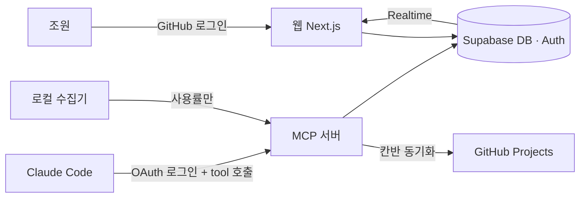

# 팀 작업 현황 3D 오피스

Claude와 대화하거나 GitHub 칸반 카드를 옮기면, 파스텔 톤 3D 사무실 안의 내 캐릭터가 알맞은 자리로 걸어갑니다.
"누가 지금 뭘 하는지"를 메신저로 묻지 않아도 방 화면 하나로 알 수 있는 팀 현황 서비스입니다.

- **GitHub 저장소 하나 = 방 하나.** 저장소를 고르면 그 저장소의 협업자가 자동으로 조원이 됩니다.
- **상태는 말 한마디로.** Claude Code에 "회의 들어가"라고 말하거나, 웹에서 버튼을 누르거나, 칸반 카드를 옮기면 됩니다.
- **한눈에.** 누가 작업 중·회의 중·휴식 중인지, 무슨 일을 하는지, 막힌 일(이슈)이 있는지, Claude 사용량(HP·MP)이 얼마나 남았는지 보입니다.

> 처음 쓰는 조원이라면 [조원으로 시작하기](#조원으로-시작하기)부터, 방을 만드는 사람이라면 [방장 안내](#방장-안내)를 함께 읽으세요.

---

## 목차

1. [주요 기능](#주요-기능)
2. [조원으로 시작하기](#조원으로-시작하기) (5분)
3. [상태를 바꾸는 세 가지 방법](#상태를-바꾸는-세-가지-방법)
4. [방 화면 읽는 법](#방-화면-읽는-법)
5. [방장 안내](#방장-안내) — 방 만들기, 칸반 연결
6. [Claude에게 할 수 있는 말](#claude에게-할-수-있는-말)
7. [직접 실행하기 (개발자)](#직접-실행하기-개발자)
8. [문제 해결](#문제-해결)
9. [보안과 개인정보](#보안과-개인정보)

---

## 주요 기능

| 기능 | 설명 |
| --- | --- |
| GitHub 로그인 · 방 만들기 | GitHub로 로그인하고 저장소를 고르면 방이 생깁니다. 저장소 협업자가 조원으로 자동 등록돼요. |
| 캐릭터 · 파트 | 방에 처음 들어갈 때 캐릭터(냥냥·새싹·삐삐·몽글)와 파트(개발·디자인·기획)를 고릅니다. 파트에 따라 자리와 옷차림이 달라져요. |
| 3D 방 | 작업 · 회의 · 휴식 · 완료 정리 · 대기 다섯 구역. 상태가 바뀌면 캐릭터가 그 구역으로 걸어갑니다. |
| 대화로 상태 변경 | Claude Code와 MCP로 연결해 "회의 들어가", "로그인 API 작업 시작"처럼 말하면 상태가 바뀝니다. |
| 웹에서 직접 선택 | Claude Code를 쓰지 않는 조원도 웹에서 상태를 고를 수 있어요. 2시간 뒤 자동 복귀 또는 직접 해제할 때까지 유지. |
| GitHub 칸반 연동 | GitHub Projects 카드를 "In progress"로 옮기면 작업 구역으로, "Done"으로 옮기면 완료 구역으로 갑니다 (약 45초 안에 반영). |
| 이슈 | 막힌 일을 Claude에게 말하면 캐릭터 머리 위에 `!`가 뜨고, 방의 이슈 보드에 모입니다. |
| HP · MP | Claude 사용량을 게이지로 보여줍니다. HP = 주간(7일) 한도, MP = 5시간 한도. MP를 다 쓰면 캐릭터가 소파에서 "MP 회복 중"이 돼요. |
| 작업 이력 | 캐릭터를 누르면 현재 작업, 경과 시간, 최근 기록이 옆 패널에 나옵니다. 1시간 넘게 같은 작업이면 "오래 지속 중 · 도움 필요?"가 붙어요. |
| 실시간 반영 | 누가 상태를 바꾸면 새로고침 없이 바로 화면에 반영됩니다. |

---

## 조원으로 시작하기

준비물: GitHub 계정, (선택) [Claude Code](https://claude.com/claude-code)

### 1. 로그인하고 방에 들어가기

1. 서비스 주소에 접속해 **GitHub로 로그인**을 누릅니다.
2. 첫 화면의 **내 방** 목록에서 팀 저장소 방을 고릅니다.
   - 목록에 없다면: 방장이 아직 방을 만들지 않았거나, 내가 그 저장소의 협업자로 등록되지 않았거나, 방이 만들어진 뒤에 협업자로 추가된 경우입니다. 방장에게 방 화면 아래 **협업자 새로고침**을 부탁하세요.
3. 처음 들어가면 **캐릭터와 파트**를 고르는 화면이 나옵니다. 둘 다 골라야 입장할 수 있어요. 나중에 바꿀 수 있습니다.

### 2. Claude Code 연결하기 (대화로 상태를 바꾸려면)

첫 화면 오른쪽 **Claude 연결** 카드에 같은 안내가 있습니다.

1. 터미널에서 **프로젝트 폴더**로 이동해 한 번 등록합니다.
   ```bash
   claude mcp add team-office --transport http <MCP 서버 주소>/mcp
   ```
   (로컬에서 돌릴 때 주소: `http://127.0.0.1:8787/mcp`)
2. Claude Code를 열고 `/mcp` → `team-office` → **Authenticate**를 고릅니다.
3. 브라우저에 "Claude Code를 팀 오피스에 연결할까요?" 화면이 열리면 **허용**을 누릅니다. "연결됐어요"가 보이면 끝이에요.
4. Claude Code에서 "회의 들어가"라고 말해 보세요. 방의 내 캐릭터가 회의 테이블로 걸어갑니다.

> 토큰을 복사하거나 붙여 넣을 필요가 없습니다. 연결을 끊고 싶으면 웹 첫 화면의 **연결된 앱 → 연결 해제**를 누르세요.

### 3. (선택) HP · MP 자동 수집기

내 PC의 Claude 사용률을 15분마다 자동으로 보고합니다. 켜지 않으면 HP·MP 게이지는 비어 있거나 직접 보고한 값만 보여요.

```bash
cd collector
cp .env.example .env                       # 처음 한 번 (Windows는 copy .env.example .env)
node --env-file=.env collector.ts --login  # 처음 한 번: 브라우저에서 허용
node --env-file=.env collector.ts          # 수집 시작 (끄려면 Ctrl+C)
```

- Node.js 22.18 이상이 필요합니다. 추가로 설치할 패키지는 없어요.
- `.env`의 `TEAM_OFFICE_MCP_URL`을 팀의 MCP 서버 주소로 바꿔 주세요.
- Claude 로그인 정보는 내 PC 밖으로 나가지 않습니다. 서버로는 사용률(%)과 리셋 시각만 보내요.

---

## 상태를 바꾸는 세 가지 방법

| 방법 | 이렇게 해요 | 이럴 때 좋아요 |
| --- | --- | --- |
| Claude에게 말하기 | "회의 들어가", "점심 먹으러 감", "로그인 화면 작업 시작" | Claude Code로 작업하는 개발자 |
| 웹에서 고르기 | 방에서 내 캐릭터를 누르고 → **내 상태 바꾸기**에서 상태 버튼 | Claude Code를 안 쓰는 디자인·기획 조원 |
| 칸반 카드 옮기기 | GitHub Projects에서 내가 담당자인 카드를 In progress / Done으로 이동 | 칸반으로 일을 관리하는 팀 (방장이 칸반을 연결해야 함) |

**우선순위**: 직접 고른 상태(Claude·웹)가 칸반보다 먼저입니다.

- **해제 방식**
  - **2시간 후 자동 복귀**(기본): 2시간이 지나면 칸반 상태로 돌아가요.
  - **직접 해제할 때까지**: **칸반으로 돌아가기**를 누를 때까지 유지돼요.
- **기본 출처** (내 상태 바꾸기 아래)
  - **칸반 따르기**: 직접 고른 상태가 없을 때 칸반 카드를 따라갑니다.
  - **직접 선택만**: 칸반을 옮겨도 내 캐릭터는 움직이지 않아요. 직접 고른 마지막 상태를 유지합니다.

칸반 열에 따라 가는 자리 (기본값, 방장이 바꿀 수 있음)

| 칸반 열 | 3D 방 |
| --- | --- |
| Backlog, Ready | 대기석 |
| In progress | 작업 구역 (말풍선에 카드 제목) |
| In review | 작업 구역 + "검토 중" 태그 |
| Done | 완료 정리 구역에 30분 → 대기석 |

---

## 방 화면 읽는 법

### 구역

| 구역 | 상태 | 위치 |
| --- | --- | --- |
| 작업 중 | `coding` | 뒤 왼쪽 — 개발은 모니터 책상, 디자인은 드로잉 책상, 기획은 화이트보드 앞 |
| 회의 중 | `meeting` | 앞 가운데 원형 테이블 |
| 휴식 중 | `break` | 앞 오른쪽 소파 |
| 완료 정리 | `done` | 앞 왼쪽 책장 앞 |
| 대기 | (칸반 결과) | 뒤 오른쪽 출입문 옆 벤치 |
| 미연결 | 상태가 아직 없음 | 가운데 통로에 반투명으로, "미연결 · 이름" 라벨 하나로 묶여요 |

### 캐릭터 위 표시

- **말풍선**: 지금 하는 일 (카드 제목은 18자까지, 진행 중 카드가 더 있으면 `+n`)
  - 주황 말풍선: 같은 작업을 1시간 넘게 하는 중 — "도움 필요?"
  - 파랑 말풍선 "MP 회복 중": 5시간 한도를 다 써서 쉬는 중
  - 대기·미연결은 말풍선이 없어요. 위쪽 **선택만**을 고르면 누른 사람 말풍선만 보여요.
- **이름표**: `[파트 배지] ● 이름 [출처 아이콘]`
  - 출처 아이콘: 🔗 칸반 연동 / ✏️⏱ 직접 선택(시간이 지나면 복귀, 10분 남으면 주황) / ✏️📌 직접 선택(해제할 때까지)
- **HP · MP 미니 게이지**: 남은 양입니다. 20% 이하면 깜빡이고, 마우스를 올리면 "100% 중 몇 % 남음"과 리셋까지 남은 시간이 보여요.
- **`!` 배지**: 열린 이슈가 있어요.

### 화면 구석

- 왼쪽 위 **이슈 보드**: 방의 열린 이슈 목록. 항목을 누르면 그 조원을 보여줍니다.
- 오른쪽 위: 칸반 마지막 동기화 시각 (실패하면 빨간색).
- 오른쪽 아래 **범례 보기**: 아이콘과 색의 뜻.
- 방 아래 **조원 n명**: 펼치면 전체 조원 목록과 **협업자 새로고침**.

### 작업 이력 패널

캐릭터나 이름표를 누르면 방 옆에 열립니다.

- **지금**: 현재 작업, 시작 시각과 경과 시간, 칸반 카드 번호·열, "GitHub에서 열기"
- **내 상태 바꾸기** (내 캐릭터일 때만): 상태 4개, 작업 내용, 해제 방식, 기본 출처, **캐릭터·파트 변경**
- **사용량**: HP · MP 남은 양
- **최근 기록**: 상태가 바뀐 이력 20개

---

## 방장 안내

방을 만든 사람이 방장입니다. 방장만 방 설정(칸반 연결)을 바꿀 수 있어요.

### 방 만들기

1. 저장소에 **GitHub App이 설치**돼 있어야 목록에 보입니다. 저장소 주인(조직이면 관리자)이 설치하세요. 방 만들기 화면 아래에 설치 링크가 있습니다.
2. 첫 화면 → **저장소로 방 만들기** → 저장소 선택 → 오른쪽에서 협업자 수와 얼굴을 확인 → **방 만들기**
3. 이미 방이 있는 저장소는 "이미 방이 있어요"로 표시되고, 고르면 협업자 목록을 다시 맞춘 뒤 **방으로 들어가기**가 됩니다.

### 칸반(GitHub Projects) 연결

방 화면 오른쪽 위 **방 설정**에서 합니다.

1. **칸반 소유**를 고릅니다.
   - **개인 계정** 칸반: 개인 접근 토큰(classic PAT)이 필요합니다.
     1. [토큰 만들기](https://github.com/settings/tokens/new?scopes=read:project&description=team-office)를 엽니다.
     2. **`read:project` 하나만** 체크하고 만료일을 정합니다.
     3. 만든 토큰을 붙여 넣습니다. 다른 권한이 있으면 거절돼요.
   - **조직** 칸반: GitHub App에 Projects 읽기 권한을 승인해야 합니다 (조직 관리자).
2. **프로젝트 URL**을 넣고 **연결 테스트**를 누릅니다. 저장소 주소가 아니라 칸반 보드 주소예요.
   - 개인: `https://github.com/users/<계정>/projects/<번호>`
   - 조직: `https://github.com/orgs/<조직>/projects/<번호>`
3. **열 매핑**을 확인합니다. 이름이 기본값(Backlog/Ready/In progress/In review/Done)과 다른 열은 노란색으로 표시되니 3D 방 위치를 직접 고르고 **열 매핑 저장**을 누르세요.
4. (선택) 프로젝트에 단일 선택 필드 **`파트`**(값: 개발 / 디자인 / 기획)를 만들면 카드마다 파트를 정할 수 있어요. 없으면 조원이 고른 파트를 씁니다.

칸반 카드는 **담당자(Assignees)** 가 방 조원인 카드만 반영됩니다. 일반 이슈, PR, 초안(draft) 카드 모두 돼요.

> 토큰은 암호화해서 서버에만 저장하고 다시 보여주지 않습니다(끝 4자리·주인·만료일만 표시). 만료되거나 폐기되면 방 화면 위에 "칸반 연결이 끊겼습니다 · 토큰 교체" 배너가 뜹니다.

---

## Claude에게 할 수 있는 말

Claude Code는 현재 폴더의 git 저장소를 보고 어느 방인지 알아냅니다. 다른 방이면 "owner/repo 방에서"라고 덧붙이세요.

| 이렇게 말하면 | Claude가 쓰는 도구 | 결과 |
| --- | --- | --- |
| "로그인 API 작업 시작" | `update_status` | 작업 구역으로 이동, 말풍선에 작업 내용 |
| "회의 들어가, 끝날 때까지 유지해줘" | `update_status` (pinned) | 해제할 때까지 회의 구역 |
| "칸반으로 돌아가" | `release_status` | 직접 선택 해제 → 칸반 상태로 |
| "로그인 화면 다 끝났어" | `log_done` | 완료 기록 + 완료 정리 구역 |
| "팀 지금 뭐 하고 있어?" | `get_team_status` | 전원의 상태·작업·HP·MP·이슈 |
| "어제 내가 뭐 했지?" | `get_member_history` | 작업 이력 |
| "결제 API가 막혔어, 이슈로 올려줘" | `report_issue` | 머리 위 `!` + 이슈 보드 |
| "이슈 12번 해결했어" | `resolve_issue` | 이슈 닫힘 |
| "HP 40%, MP 70% 썼어" | `report_usage` | HP·MP 게이지 갱신 (수집기를 안 쓸 때) |

남의 상태는 바꿀 수 없고, 내가 속한 방의 정보만 볼 수 있어요.

---

## 직접 실행하기 (개발자)

### 구성

```
web/          웹 (Next.js 16, React Three Fiber) — 로그인, 방 화면, 설정, MCP 연결 동의 화면
mcp-server/   MCP 서버 (Node.js) — Claude Code·수집기가 부르는 tool 8개 + GitHub 칸반 동기화(45초)
collector/    로컬 수집기 (Node.js, 의존성 없음) — Claude 사용률 → report_usage
supabase/     DB 마이그레이션(PostgreSQL + RLS), Auth 설정(config.toml), RLS 검사
```



### 필요한 것

- Node.js 24 (웹·MCP 서버), 22.18 이상 (수집기)
- [Supabase](https://supabase.com) 프로젝트와 [Supabase CLI](https://supabase.com/docs/guides/cli)
- GitHub App (아래 스크립트가 만들어 줍니다)

### 1. DB와 인증 준비

```bash
supabase login                          # 별도 터미널에서 (대화형)
supabase link --project-ref <프로젝트 ref>
supabase db push --dry-run              # 적용될 마이그레이션 확인
supabase db push --linked
supabase config diff                    # 의도한 항목만 바뀌는지 확인 (GitHub 로그인, OAuth 서버)
supabase config push
```

- secret 키는 `supabase projects api-keys --reveal`로 받습니다 (`--reveal`이 없으면 가려진 값이 나와요).
- `config push`에는 GitHub 로그인 값이 필요합니다. 실행하는 셸에 `GITHUB_APP_CLIENT_ID`, `GITHUB_APP_CLIENT_SECRET` 환경 변수를 넣으세요.

### 2. GitHub App 만들기

```bash
cd web
node scripts/create-github-app.mjs   # 브라우저에서 App을 만들고 web/.env.local에 값을 채워 줍니다
```

### 3. 환경 변수

| 파일 | 예시 파일 | 주요 값 |
| --- | --- | --- |
| `web/.env.local` | `web/.env.example` | Supabase URL·publishable·secret 키, `SITE_URL`, `MCP_SERVER_URL`, GitHub App 값, `GITHUB_TOKEN_ENC_KEY` |
| `mcp-server/.env` | `mcp-server/.env.example` | Supabase URL·secret 키, `MCP_PUBLIC_URL`, `GITHUB_SYNC_SECONDS`, `GITHUB_TOKEN_ENC_KEY`, GitHub App client id·private key |
| `collector/.env` | `collector/.env.example` | `TEAM_OFFICE_MCP_URL` |

- `GITHUB_TOKEN_ENC_KEY`(방장 PAT 암호화 키, 32바이트 base64)는 웹과 MCP 서버에 **같은 값**을 넣습니다.
  - 만들기: `node -e "console.log(require('crypto').randomBytes(32).toString('base64'))"`
- `.env*` 파일은 커밋하지 마세요.

### 4. 실행

MCP 서버를 Claude Code보다 먼저 켜세요.

```bash
cd mcp-server && npm install && npm start   # http://127.0.0.1:8787/mcp (칸반 동기화 포함)
cd web && npm install && npm run dev         # http://localhost:3000
```

### 5. 검사

```bash
cd mcp-server && npm run check && npm test   # 타입 검사 + e2e 33개 (원격 Supabase에 테스트 데이터를 만들고 지움)
cd web && npx tsc --noEmit && npm run lint && npm run build
cd collector && node collector.test.ts
```

RLS 검사는 `supabase/tests/rls_check.sql`입니다. 실행 방법은 `CLAUDE.md`를 보세요.

### 더 읽을거리

- `PRD.md` — 요구사항, 기능 ID(F1~F21), 데이터 모델, MCP tool 명세, 마일스톤
- `CLAUDE.md` — 개발 규칙, 명령, 아키텍처 원칙
- `design-guide.md` — 화면 디자인 기준 (시안 v3)

---

## 문제 해결

| 증상 | 해결 |
| --- | --- |
| `claude mcp add` → "already exists in local config" | 이미 등록돼 있다는 뜻이에요. `/mcp` → team-office → Authenticate만 하면 됩니다. 다시 등록하려면 `claude mcp remove team-office -s local` 후 add. |
| Claude Code에서 team-office가 "Failed to connect" (ECONNREFUSED) | MCP 서버가 꺼져 있어요. 서버를 켠 뒤 Claude Code를 다시 시작하세요. |
| `/mcp`에 "Needs authentication" | 등록은 됐고 로그인만 남았어요. Authenticate를 고르세요. |
| 허용 화면에서 "연결됐어요" 뒤에도 Claude Code가 연결 안 됨 | 화면의 "반영되지 않았다면 여기를 누르세요" 링크를 누르세요. |
| 수집기 "MCP 로그인 정보가 없습니다" / "연결이 해제됐습니다" | `node --env-file=.env collector.ts --login`을 다시 실행하세요. |
| 방 만들기에 저장소가 안 보임 | 그 저장소에 GitHub App이 설치돼 있는지 확인하세요. 조직 저장소는 관리자 승인이 필요해요. |
| 내 방이 목록에 없음 | 방이 만들어진 뒤 협업자로 추가됐다면, 방 조원 누구든 방 화면 아래 **협업자 새로고침**을 누르면 들어옵니다. |
| 칸반을 옮겨도 캐릭터가 안 움직임 | ① 카드 **담당자**가 나인지 ② 내 **기본 출처**가 "칸반 따르기"인지 ③ 직접 고른 상태가 남아 있지 않은지(**칸반으로 돌아가기**) ④ 오른쪽 위 동기화가 실패로 나오지 않는지 확인하세요. |
| 직접 고른 상태가 2시간이 지나도 그대로 | 기본 출처가 "직접 선택만"이면 마지막 상태를 유지하는 게 정상이에요. |
| `npm run dev`가 "Another next dev server is already running" | 3000번 포트를 쓰는 node 프로세스를 종료하고 다시 실행하세요. |

---

## 보안과 개인정보

- **방 데이터**: 그 방의 조원만 볼 수 있어요. DB 행 단위 보안(RLS)으로 막습니다.
- **MCP 로그인**
  - 토큰은 Supabase OAuth가 발급하고 보관해요. 웹과 MCP 서버는 토큰을 저장하지 않습니다.
  - 웹에서 **연결 해제**를 누르면 바로 차단돼요.
- **Claude 사용량**
  - 수집기는 내 PC의 Claude 로그인 정보로 사용률만 조회합니다.
  - 서버로는 숫자(%)와 리셋 시각만 보내요.
- **칸반 토큰(PAT)**: `read:project` 권한 하나만 받고, 암호화해 서버에만 저장합니다. 화면에는 끝 4자리만 보여요.
- **GitHub App 권한**: 저장소 메타데이터와 이메일 읽기뿐이에요. 코드를 읽거나 쓰지 않습니다.
