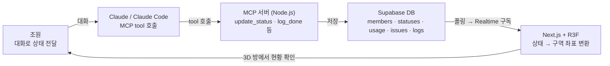

# 팀 작업 현황 3D 오피스 기획서

2026-11-17

## 1. 프로젝트 개요

조원이 AI와 대화만 하면 작업 상태가 기록되고, 그 상태가 아이소메트릭 3D 방 안의 캐릭터 위치로 실시간 표시되는 팀 현황 서비스다.

- **배경:** 팀 프로젝트에서 "누가 지금 무엇을 하는지"를 확인하려면 메신저를 뒤지거나 매번 물어봐야 한다.
- **목표:** MCP로 상태 입력을 자동화하고, 3D 공간 화면으로 팀 현황을 한눈에 파악하게 한다.
- **포트폴리오 포인트:** MCP 서버 설계, 상태 기반 3D UI 렌더링, 실시간 데이터 반영을 한 프로젝트에서 보여준다.

## 2. 핵심 용어 정리

| 용어 | 쉬운 설명 |
| --- | --- |
| MCP | AI가 외부 프로그램의 기능(tool)을 호출하게 해주는 규격. 대화만으로 상태 저장이 가능해진다 |
| 아이소메트릭 | 위에서 비스듬히 내려다본 입체 느낌의 표현 방식 |
| WebGL | 브라우저가 그래픽카드로 3D를 그리게 하는 기술 |
| Three.js | WebGL을 쉽게 쓰게 해주는 3D 라이브러리 |
| React Three Fiber (R3F) | Three.js를 React 컴포넌트처럼 쓰게 해주는 라이브러리 |
| drei | R3F용 도구 모음(카메라 조작, 모델 로딩 등) |
| 정사영 카메라 | 멀어도 물체가 작아지지 않는 카메라. 아이소메트릭 느낌의 핵심 |
| 폴링 | 일정 시간마다 서버에 데이터를 다시 요청하는 방식 |

## 3. 주요 기능과 status 정의

상태는 4가지로 고정하고, 각 상태는 방 안의 정해진 구역에 대응한다.

| status | 표시 이름 | 방 안 위치 | 의미 |
| --- | --- | --- | --- |
| coding | 개발 중 | 컴퓨터 책상 | 기능 구현·디버깅 중 |
| meeting | 회의 중 | 원형 테이블 | 팀 회의·페어 작업 중 |
| break | 휴식 중 | 소파 | 자리 비움·휴식 |
| done | 완료 정리 | 책장 앞 | 작업 완료 후 기록 정리 |

**주요 기능**

1. 대화로 상태 변경: "로그인 API 작업 시작"이라고 말하면 MCP가 상태를 저장한다.
2. 3D 방 렌더링: 상태에 따라 캐릭터가 해당 구역으로 이동하고 말풍선에 작업 내용을 띄운다.
3. 작업 이력 패널: 캐릭터를 클릭하면 현재 작업과 완료 기록을 보여준다.
4. 장기 작업 경고: 같은 작업이 오래 지속되면 말풍선 색을 바꿔 도움 필요를 표시한다.
5. HP·MP 바: Claude 사용량을 캐릭터 머리 위 게임 게이지로 표시한다.
6. 이슈 배지·이슈 보드: 막힌 조원 머리 위에 `!`를 띄우고, 벽면 이슈 보드에서 전체 목록을 연다.

**HP·MP 정의**

| 게이지 | 실제 한도 | 특징 |
| --- | --- | --- |
| HP | 주간 한도(7일) | 총량. 바닥나면 회복까지 며칠 걸릴 수 있음 |
| MP | 5시간 세션 한도 | 단기 사용량. 5시간 단위로 회복 |

- 플랜마다 한도 크기가 다르므로 절대값이 아닌 사용률(%)로 저장한다.
- MP가 바닥난 조원은 `break` 구역으로 보내 "MP 회복 중"을 표시한다.
- 이슈는 4가지 status와 별개인 배지로 처리해 "개발 중인데 막힘"도 표현한다.

## 4. 시스템 아키텍처

상태 쓰기는 MCP 서버만 담당하고, 프론트엔드는 DB를 읽어 3D 방에 그리기만 한다.



조원의 말 한마디가 Claude → MCP 서버 → DB를 거쳐 저장되고, 화면은 그 데이터를 읽어 캐릭터를 해당 구역에 배치한다.

**로컬 수집기 (HP·MP 전용)**

사용량은 각 조원 PC에서 도는 로컬 수집기가 조회하고, 사용률 숫자만 서버로 보낸다. 인증 토큰은 PC 밖으로 나가지 않는다.

```
[조원 PC] 로컬 수집기 (Node 스크립트, 10~15분 간격)
   │ ~/.claude/.credentials.json 의 토큰으로 사용량 조회
   │ { hp, mp, resets_at } 만 전송
   ▼
[MCP 서버 / DB] → [3D 방: HP·MP 바]
```

- 조회 대상은 Claude Code가 내부적으로 쓰는 비공개 사용량 엔드포인트(`/api/oauth/usage`)로, 서드파티 분석 기준 `five_hour`(MP), `seven_day`(HP)의 사용률과 리셋 시간을 돌려준다.
- 엔드포인트가 막히거나 바뀌면 자기 보고 방식(`report_usage`)으로 대체한다.

## 5. 기술 스택과 3D 렌더링 방식

3D 화면은 Next.js만으로 그릴 수 없으므로 Next.js + React Three Fiber 조합을 채택한다.

| 영역 | 기술 | 역할 |
| --- | --- | --- |
| 프론트엔드 | Next.js, TypeScript | 페이지 구성, 라우팅, API 호출 |
| 3D 렌더링 | Three.js, React Three Fiber, drei | 방·가구·캐릭터 3D 표현 |
| MCP 서버 | Node.js, @modelcontextprotocol/sdk, zod | AI가 호출할 tool 제공, 입력값 검증 |
| DB | Supabase (대안: MongoDB) | 조원·상태·로그 저장 |
| 배포 | Vercel(프론트), 별도 서버(MCP) | 서비스 공개 |

**렌더링 방식 비교**

| 기준 | CSS 아이소메트릭 | Three.js |
| --- | --- | --- |
| 회전·줌 | 어려움 | 쉬움 |
| 조명·그림자 | 이미지에 그려 넣어야 함 | 실시간 계산 |
| 학습 난이도 | 낮음 | 중간~높음 |
| 성능 부담 | 가벼움 | 상대적으로 무거움 |

선택 근거: 정사영 카메라로 아이소메트릭 느낌을 유지하면서 회전·줌·조명 확장이 가능하다.

## 6. 데이터 모델과 MCP tool 설계

데이터는 5개 테이블, MCP tool은 7개로 구성한다. tool은 입력 검증 후 DB에 저장만 하는 얇은 함수로 유지한다.

**데이터 모델**

| 테이블 | 주요 필드 | 설명 |
| --- | --- | --- |
| members | id, name, avatar_color | 조원 정보 |
| statuses | member_id, status, task, started_at | 조원별 현재 상태(1인 1행) |
| usage | member_id, hp_pct, mp_pct, hp_resets_at, mp_resets_at, source, updated_at | HP·MP 사용률. source는 자동/자기 보고 구분 |
| issues | id, member_id, title, state, created_at | 이슈(open/resolved) |
| logs | member_id, task, status, created_at | 상태 변경·완료 이력 |

**MCP tool**

| tool | 입력 | 동작 |
| --- | --- | --- |
| update_status | name, status, task | 현재 상태 변경 + logs 기록 |
| log_done | name, task | 완료 작업 기록, 상태를 done으로 변경 |
| get_team_status | 없음 | 팀 전체 상태·HP·MP·이슈 조회 |
| get_member_history | name, 기간 | 특정 조원 작업 이력 조회 |
| report_usage | name, hp_pct, mp_pct | HP·MP 저장(로컬 수집기 또는 자기 보고) |
| report_issue | name, title | 이슈 등록 |
| resolve_issue | issue_id | 이슈 해결 처리 |

## 7. 화면 설계와 코드 방향성

상태와 좌표를 하나의 설정 객체로 묶어, DB 데이터만 바뀌면 캐릭터가 자동으로 이동하게 한다.

```ts
// 상태 → 방 안 좌표(x, y, z) 매핑
const STATUS_SPOTS = {
  coding:  { label: '개발 중',  zone: 'desk',  pos: [-2, 0, -1] },
  meeting: { label: '회의 중',  zone: 'table', pos: [1, 0, 1.5] },
  break:   { label: '휴식 중',  zone: 'sofa',  pos: [2.5, 0, -1] },
  done:    { label: '완료 정리', zone: 'shelf', pos: [-2.5, 0, 1] },
} as const;
```

- **컴포넌트 구성:** `Room`(바닥·벽), `Furniture`(구역별 가구), `Avatar`(캐릭터+말풍선), `GaugeBar`(HP·MP), `IssueBoard`(벽면 이슈 보드), `HistoryPanel`(이력 패널)
- **HP·MP 바:** drei의 `Html`로 캐릭터 머리 위에 HTML 게이지를 붙인다. HP는 빨강, MP는 파랑, 20% 이하면 깜빡임, 옆에 리셋까지 남은 시간 표시.
- **이슈 배지:** open 이슈가 있으면 머리 위에 `!` 아이콘을 띄운다.
- **클라이언트 전용 처리:** 3D 컴포넌트에 `'use client'`를 붙이고, 필요하면 `next/dynamic`으로 `ssr: false` 처리한다.
- **자리 겹침 방지:** 같은 구역 인원에게 구역별 오프셋을 줘 나란히 배치한다.
- **에셋:** 처음엔 기본 도형으로 만들고, 이후 무료 라이선스 3D 모델로 교체한다.
- **데이터 갱신:** 5~10초 폴링으로 시작해 Supabase Realtime 구독으로 전환한다.

## 8. 실무 활용 사례

원격·하이브리드 팀의 "가상 사무실" 개념으로, 다음 상황에서 바로 쓸 수 있다.

| 상황 | 활용 방법 | 기대 효과 |
| --- | --- | --- |
| 데일리 스탠드업 | 아침에 각자 AI에게 오늘 할 일을 말하면 방에 반영 | 회의 없이 팀 현황 파악 |
| 병목 발견 | 같은 작업이 오래 지속된 캐릭터를 경고 색으로 표시 | 도움이 필요한 사람 조기 발견 |
| 주간 회고 | 완료 로그를 기간별로 조회 | 회고 자료 자동 확보 |
| 팀 프로젝트 발표 | 시연 화면으로 팀 협업 과정을 시각화 | 협업 방식 어필 |

## 9. 개발 로드맵과 주의사항

데이터 → MCP → 화면 순서로 쌓아, 각 단계가 끝날 때마다 동작을 확인한다. 일정은 팀 확정 후 기입한다.

1. 데이터 모델 확정, Supabase 테이블 생성
2. MCP 서버 tool 구현, Claude에서 호출 테스트
3. 기본 도형으로 3D 방과 4개 구역 배치
4. 상태 데이터 연동, 캐릭터 이동·말풍선 표시
5. 이슈 배지·이슈 보드, 이력 패널, 장기 작업 경고 추가
6. HP·MP 바: 자기 보고(`report_usage`)로 먼저 구현
7. 로컬 수집기로 HP·MP 자동 수집 전환
8. 3D 모델 교체, Realtime 전환, 배포

**리스크와 주의사항**

- 참고 이미지는 워터마크가 있는 스톡 이미지라 분위기 참고용으로만 쓰고, 에셋은 라이선스를 직접 확인한다.
- 3D 모델이 무거우면 저사양 기기에서 느려지므로 모델 수와 용량을 제한한다.
- MCP 서버가 외부에 공개되면 아무나 상태를 바꿀 수 있으므로 인증 방식을 정해야 한다.
- 사용량 엔드포인트는 공식 문서에 없는 비공개 API라 예고 없이 바뀔 수 있다. 자기 보고 방식을 대체 경로로 유지한다.
- 인증 토큰은 계정 열쇠와 같으므로 로컬 수집기 밖으로 절대 전송하지 않는다.
- 조회 주기는 10~15분 이상으로 두어 과도한 호출을 피한다.
- 엔터프라이즈 플랜은 해당 엔드포인트에서 사용량이 오지 않는다는 보고가 있어 자기 보고만 가능할 수 있다.
- 비공개 엔드포인트 자동 호출이 이용 약관상 허용되는지는 미확인. 공개 배포 전 확인한다.
- 열린 질문: 조원 인원 수, MCP 서버 배포 위치, 인증 방식, 조원별 플랜 종류
